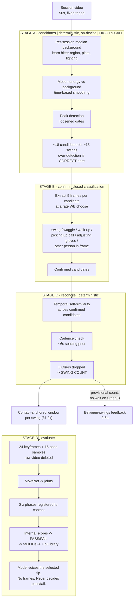

# DugOut — Swing Segmentation: Technical Design & Test Plan v1.0

**Date:** 2026-08-30 · **Jira:** **DUG-54** (the defect in §1, filed 2026-08-30) · DUG-34 (segmentation) · DUG-50 (VLM)
**Scope:** finding swing boundaries, counting swings in a session, and registering the six checkpoints against them. Feedback composition is out of scope — see `DugOut_Realtime_VLM_Plan_v1.0.md`.

---

## 0. What this document is

A design for the three-stage problem: **where does a swing start and stop → how many swings are in this session → what happens in each one.** It is written test-first, because the pipeline has now failed twice in the field and both failures were invisible to the tests that existed.

It also documents a defect found while writing it, which is more serious than either previous failure.

---

## 1. The defect: checkpoint phases are mis-registered against contact — DUG-54

**Severity: high. Silent. Almost certainly present in every evaluation the app has ever produced.**

### What the code does

`config.js` maps the six checkpoints to **fractions of the swing window**, anchored on contact at `CONTACT_ANCHOR: 0.62`:

```
stance  0.00–0.14     hips     0.50–0.62
load    0.12–0.34     contact  0.58–0.72
stride  0.32–0.52     finish   0.72–1.00
```

`segment.js` then builds the window like this:

```js
contactT = nearest audio ping within AUDIO_CONFIRM_SEC (0.75) of peakT, else peakT

if (end - start > SWING_TIGHTEN_SEC /* 3.0 */) {
  start = max(start, contactT - 1.86)     // 3.0 × 0.62
  end   = min(end,   contactT + 1.14)     // 3.0 × 0.38
}
return { start: start - PRE_PAD_SEC /* 1.0 */,
         end:   end   + POST_PAD_SEC /* 1.0 */, contactT }
```

### Where contact actually lands

| Case | Window | Duration | Contact at |
|---|---|---|---|
| Short swing, no audio ping | `[peak−1.15, peak+1.15]` | 2.30s | **0.500** |
| Short swing, ping ~0.6s after peak | `[peak−1.15, peak+1.15]` | 2.30s | **0.761** |
| Long span, tightened | `[contact−2.86, contact+2.14]` | 5.00s | **0.572** |

The design expects **0.62** in all three. It is never 0.62.

The tighten branch was written specifically to keep the phase map meaningful — the comment says so — and then the unconditional ±1.0s padding applied immediately afterwards dilutes contact back toward the middle and undoes it. **The padding defeats the tighten.**

### Why this is worse than a missed swing

A missed swing is visible: the user sees "found 3" when they took 12. This is invisible. The output still renders six plausible PASS/FAIL marks.

At contact fraction 0.50, the frames graded as **Contact** (0.58–0.72) sit entirely *after* real contact — that's follow-through being graded as contact — while **Hips Fire** (0.50–0.62) is grading the actual contact moment. Every checkpoint is shifted by roughly one phase.

And the error **flips direction depending on whether audio confirmed the swing**: unconfirmed swings register early (0.50), confirmed ones late (0.76). So within a single session, a whiff and a solid contact get oppositely mis-registered. That surfaces as inconsistent grades on visually identical swings — precisely the symptom that destroys a trainer's confidence, and precisely the thing Mike White would notice on his first look without being able to name it.

### Two related inconsistencies in the same code path

1. **`AUDIO_CONFIRM_SEC` may be too small to ever fire on cage footage.** The comment above it records a measured peak→ping offset of **0.5–0.7s** on backyard footage, but the gate comment 20 lines earlier records **"pitch_01: smoothed peak 6.4s, contact ping 7.43s"** — a 1.03s offset. If 1.03s is representative of cage footage, the 0.75s window excludes the real ping, `contactT` silently falls back to `peakT`, and the swing is treated as a whiff. The two measurements in the file disagree and neither has been checked against more than one clip.

2. **Whiffs have no contact estimate at all.** `contactT = peakT` for any unconfirmed swing. Since the motion peak leads real contact by roughly half a second, every whiff is registered systematically early — on top of the padding error.

### The fix

Stop deriving the window from spike boundaries. **Construct it from contact.**

```js
const pre  = SWING_WINDOW_SEC * CONTACT_ANCHOR;
const post = SWING_WINDOW_SEC * (1 - CONTACT_ANCHOR);
return { start: contactT - pre, end: contactT + post, contactT };
```

Contact then sits at `CONTACT_ANCHOR` **by construction, for every swing, always**. No tighten branch, no padding, no case analysis. `SWING_TIGHTEN_SEC`, `PRE_PAD_SEC` and `POST_PAD_SEC` leave the swing-window path entirely.

For unconfirmed swings, estimate `contactT = peakT + PEAK_TO_CONTACT_SEC` using a value **measured across the fixture corpus**, not inferred from one clip.

This is a small diff. The reason it needs a test corpus behind it is that the previous two fixes were also small diffs.

---

## 2. Constraints that fix the architecture

**Hosted models cannot find swings.** Gemini samples video at a hard 1 FPS — no `fps` parameter, no `videoMetadata` override; `media_resolution` changes tokens per frame (258 default / 66 low), not the rate. Claude has no native video input. A swing is 130–280ms. At 1 FPS a model never sees one.

The consequence is not "use a different model." It is: **a model can only ever confirm a candidate we found ourselves.** Frames we extract and send as *images* bypass the 1 FPS ceiling entirely — that is the only path, and it means detection stays deterministic and on-device forever.

**The camera is fixed.** A tripod means a per-session median background, a stable hitter region, a constant plate location, and one lighting baseline. The July failure — shimmer producing blobs in 98% of frames and 1,810 phantom tracks — is a fixed-camera problem that a per-session background model largely dissolves. We currently throw this away and difference consecutive frames instead.

**The session is repetitive.** ~15 instances of the same motion, same athlete, same screen position, same light, ~6s apart. The problem is not "detect a swing" (general, hard) but "find the N repetitions of one recurring event" (specific, self-supervising). A temporal self-similarity matrix over cheap per-frame descriptors gets this with no model and no training data — the technique [RepNet](https://arxiv.org/abs/2006.15418) formalises.

**Cadence is a free prior.** A JUGS carousel feeds every ~6s. Real swings are roughly evenly spaced; a "swing" 1.2s after another one is a follow-through counted twice.

---

## 3. The cascade

Today `segment.js` tries to be both complete and precise in one gate, balanced across six thresholds tuned on two clips. That balance will not survive a new cage. Split the objectives so each stage can be individually dumb.



**Stage B is the only place a model touches detection, and it is a closed classification with a fixed answer set.** That is the structural opposite of the prompt that broke Gemini on the golf swing, where "give me tips" was read as "find a problem." There is no reward for inventing anything here. Cost: ~18 candidates × 5 frames at 640×360 ≈ 27k tokens ≈ **$0.03/session**, run once at session end.

For between-swings feedback, Stage B is off the critical path: A and C are instant and deterministic, the live count is provisional, and B reconciles at the end.

**Stage B should not be a VLM forever.** Once DUG-45 lands native `AVCaptureSession`, Apple Vision gives joints at high frame rate, free and offline. A swing has a very distinctive joint signature — hip–shoulder separation reversing, hands crossing the torso, a sharp bat-side wrist velocity peak. A pose classifier on that will beat a VLM, cost nothing, and work in a cage with no signal. Treat the VLM as the bridge to the pilot, not the destination.

---

## 4. The swing window

```
        ← pre = W × 0.62 →   ← post = W × 0.38 →
   ─────┬────────┬────────┬────┬────┬──────────┬─────
        │ stance │  load  │strd│hips│ CONTACT  │ finish
        0.00    0.14     0.34 0.52 0.62       0.72   1.00
                                     ▲
                              contactT, ALWAYS
```

Rules:

1. `contactT` is the anchor. The window is derived from it, never the reverse.
2. Audio-confirmed: `contactT` = the ping. Unconfirmed: `contactT = peakT + PEAK_TO_CONTACT_SEC`, measured.
3. Fixed duration `SWING_WINDOW_SEC`. Every window is the same length, so a phase fraction means the same real duration on every swing.
4. **The window must contain the finish.** Finish is a graded checkpoint; if the clip ends at contact the engine cannot grade it, model or no model. This is also the MoHallBench failure mode — truncating before the terminal event drove video-LLM accuracy from 80.4% to 5.9%.
5. Clamp at session boundaries; a swing in the first or last second is flagged `partial` and excluded from checkpoint grading rather than graded on a short window.

---

## 5. Config changes

| Constant | Now | Proposed |
|---|---|---|
| `SWING_WINDOW_SEC` | — | **new**, 2.6 (tune on corpus) |
| `PEAK_TO_CONTACT_SEC` | — | **new**, measure; ~0.6 provisional |
| `SWING_TIGHTEN_SEC` | 3.0 | **remove** from window path |
| `PRE_PAD_SEC` / `POST_PAD_SEC` | 1.0 / 1.0 | **remove** from window path |
| `AUDIO_CONFIRM_SEC` | 0.75 | re-derive; file records both 0.5–0.7s and 1.03s offsets |
| `SPIKE_ENTER_MULT` | 3.0 | loosen for Stage A recall |
| `MAX_SPIKE_MULT` | 12 | move to Stage B/C, not Stage A |
| `BALL_*` gate | — | demote to a Stage C *hint*, not a Stage A filter |
| `DEBUG` | true | false before any build that leaves the Mac |

---

## 6. Test-driven development plan

### Why test-first, specifically here

This pipeline has failed in the field twice. Both times the fix was verified against two clips and both times the verification passed. The problem is not fix quality — it's that **two clips cannot distinguish a correct pipeline from one overfitted to two clips.** Section 1's defect survived both rounds precisely because no test asserted anything about where contact sits inside the window.

So: fixtures and assertions first, cascade second. Every failure below should be a red test before it is a fix.

### 6.1 The fixture corpus — the actual blocker

We have **five labelled events**: `Three Swings.mov` (contacts at 4.27 / 31.58 / 57.29) and `pitch_01.mov` (2). That is enough to overfit and nothing else.

**Target: 25 labelled sessions.** Deliberately varied:

| Dimension | Coverage needed |
|---|---|
| Venue | indoor cage, outdoor cage, backyard, batting tunnel |
| Light | daylight, dusk, sodium/LED indoor, mixed |
| Feed | machine, front toss, soft toss, tee, live |
| Handedness | left and right |
| Age/size | at least one from each of 7–10, 11–13, 14–18 |
| **Adversarial** | kid wanders off · someone crosses frame · phone bumped · two hitters alternating · swings with no contact (whiffs) · practice waggles between pitches · foul tips |

Label format — one CSV per session, plus a session manifest:

```csv
session_id,contact_t,outcome,notes
threeswings,4.27,hit,
threeswings,31.58,hit,
threeswings,57.29,hit,
```

`outcome` ∈ `hit | whiff | foul | tee`. Scrub to each contact, write the timestamp. **This is an evening of work and it is the highest-leverage non-coding task on the project** — every threshold decision after it stops being a guess. Source material already exists in `Design & UX/media/` (`IMG_0768.mov`, `IMG_0769.mov`), plus a son who goes to a cage.

Five adversarial sessions must be **negative fixtures**: sessions where the correct answer is a specific small number, including at least one where it is zero.

### 6.2 Harness

Headless Chromium + Playwright against the real `segment.js` — the July method, kept. Serve the repo, load the module, run against fixtures, assert.

- Headless Chromium has no H.264/AAC: remux fixtures to VP9/Opus webm once, commit the *manifest* not the video.
- Fixture video stays in `Design & UX/media/fixtures/` (assets workspace, never the repo). CSVs and manifest are small and **do** go in the repo.
- Every accuracy test runs **5 times**; a test that is not deterministic across 5 runs is a failure, not a flake. This pipeline has produced non-deterministic results before.

### 6.3 Tier 1 — unit, no video

Pure functions, milliseconds, run on every save.

| Test | Assertion |
|---|---|
| `window/anchor` | For contactT ∈ {0.5, 5, 44.9} and every `outcome`, `(contactT − start) / (end − start)` = `CONTACT_ANCHOR` ± 0.001 |
| `window/duration` | Every window is `SWING_WINDOW_SEC` ± 0.001, regardless of input span length |
| `window/invariance` | Two swings with identical contactT but spans of 0.2s and 7.0s produce **identical** windows |
| `window/confirmed-vs-whiff` | An audio-confirmed swing and a whiff at the same true contact produce windows within 50ms of each other |
| `window/clamped` | contactT at 0.3s → `partial: true`, excluded from grading, not silently short |
| `phase/coverage` | The six `PHASE_WINDOWS` cover 0→1 with no gap; `contact` straddles `CONTACT_ANCHOR` |
| `phase/finish-present` | The finish phase maps to real frames after contactT for every window |
| `cadence/dedupe` | Two peaks 0.4s apart collapse to one; two 6.1s apart stay two |

**`window/anchor` fails today.** That is the point — it is the regression test for §1, and it should go red before the fix lands.

### 6.4 Tier 2 — detection accuracy, on the corpus

A detection matches ground truth if `|detected contactT − true contactT| ≤ 250ms`.

| Metric | Gate |
|---|---|
| **Recall** (true swings found) | ≥ 0.95 across the corpus, ≥ 0.90 on every individual session |
| **Precision** after Stage C | ≥ 0.92 |
| **Count accuracy** (‖detected‖ = ‖true‖ exactly) | ≥ 0.80 of sessions |
| **Count within ±1** | ≥ 0.95 of sessions |
| **Contact error, median** | ≤ 80ms |
| **Contact error, p95** | ≤ 250ms |
| **Negative fixtures** | zero false swings on the empty session; ≤1 on each adversarial |
| **Stage A recall alone** (before B/C) | ≥ 0.98 — Stage A must not be the bottleneck |

Report as a table per session, never as a single number. A pipeline at 0.95 recall overall that returns 0.4 on one indoor cage is a broken pipeline with a good average.

### 6.5 Tier 3 — Stage B classifier

| Test | Assertion |
|---|---|
| `stageB/true-positive` | ≥ 0.95 of ground-truth swings classified `swing` |
| `stageB/waggle` | ≥ 0.85 of labelled practice waggles rejected |
| `stageB/walkup` | ≥ 0.90 of walk-ups and gear adjustments rejected |
| `stageB/closed-set` | Any response outside the fixed answer set = hard failure, not a retry |
| `stageB/determinism` | Same 5 frames, 5 calls → same label ≥ 4 times |
| `stageB/offline` | With no key and no network, Stage B is skipped and A+C alone still meet Tier 2 gates minus 5 points of precision |

That last one is the invariant that matters most: **the app must segment correctly with no API key.** It is already a stated architecture invariant in `CLAUDE.md` and it is what makes the offline cage demo work.

### 6.6 Tier 4 — end-to-end regression gate

Runs before any delivery. Fails the build.

1. Full pipeline on all 25 fixtures, 5 runs, all Tier 2 gates green.
2. Zero console errors, zero page errors, zero failed requests at iPhone viewport with all external network blocked.
3. Zero external network references in the entry point.
4. Raw video released after segmentation — assert the object URL is revoked and nothing raw persists to IndexedDB.
5. No SharePoint injection (`xmlns:mso`, `CustomDocumentProperties`, blanked `<title>`).

### 6.7 Definition of done

- [ ] 25 sessions labelled, manifest committed
- [ ] `window/anchor` red, then green — §1 fixed
- [ ] `PEAK_TO_CONTACT_SEC` and `AUDIO_CONFIRM_SEC` derived from the corpus, both comments in `config.js` corrected to cite it
- [ ] Stage A rebuilt on a per-session background model, recall ≥ 0.98
- [ ] Stage C self-similarity + cadence implemented
- [ ] All Tier 1–4 gates green, 5 consecutive runs
- [ ] Confirmed on Derell's iPhone with a real cage round

---

## 7. Build order

| # | Work | Depends on | Why here |
|---|---|---|---|
| 1 | Fixture corpus | — | Everything else is guesswork without it |
| 2 | Tier 1 unit tests | — | Hours, no video, catches §1 immediately |
| 3 | **§1 window fix** | 2 | Small diff, high severity, silently wrong today |
| 4 | Harness + Tier 2 on corpus | 1 | Establishes the real baseline |
| 5 | Stage A: background model, loosened gates | 4 | Recall first |
| 6 | Stage C: self-similarity + cadence | 5 | Precision back, still no model |
| 7 | Stage B: VLM confirmation | 6 | Only if 5+6 miss the gates |
| 8 | UX escape hatch: swipe to delete a swing | 5 | Ships value before 6/7, and every deletion is a free label |

**Steps 1–3 are worth doing before the pilot regardless of anything else in this document.** Steps 5–7 are the R2/R3 window.

Note the ordering claim in step 7: if a per-session background model plus self-similarity plus a cadence prior hits the Tier 2 gates on their own, **Stage B does not get built**. The cheapest model call is the one you don't make.

---

## 8. The UX escape hatch

Don't chase a perfect count. Show it: *"Found 12 swings"*, with a reel where a bad one swipes away and a gap can be tapped to add a missed one.

It's honest, it's one tap, and every correction is a labelled example flowing back into the corpus. It turns the weakest part of the system into the thing that improves it — and it ships after step 5, well before the cascade is finished.

---

## 9. Open questions

1. **`SWING_WINDOW_SEC` = 2.6?** Needs to cover setup through full follow-through for a 7-year-old and a 17-year-old. May need to be age-banded — the config already supports per-band overrides.
2. **Two hitters alternating in frame.** Common at a cage. Stage C's self-similarity would cluster them into two groups, which is arguably the right answer — but which one is *this* profile's? Probably needs the hitter region locked at session start.
3. **Tee work has no ball flight and no pitch cadence.** The cadence prior and the ball gate both go silent. Does tee mode need its own Stage A path?
4. **Foul tips** produce a contact ping with no clean swing finish. Grade or exclude?
5. **`MIN_FAULT_SWINGS: 2` / `MIN_FAULT_SHARE: 0.25`** (ER-03) assume an accurate count. A session mis-counted at 8 instead of 12 changes which faults clear the threshold — the count error propagates into the determination. Worth an explicit test once counting is stable.

---

## Cross-references

`claude/realtime-vlm-plan.md` · `claude/mvp-and-release-ladder.md` · repo `CLAUDE.md` (verification bar) · `js/config.js`, `js/segment.js`, `js/evaluate.js`
Sources: [Gemini video understanding — fixed 1 FPS](https://ai.google.dev/gemini-api/docs/video-understanding) · [RepNet, arXiv 2006.15418](https://arxiv.org/abs/2006.15418) · [MoHallBench, arXiv 2607.01117](https://arxiv.org/abs/2607.01117)
