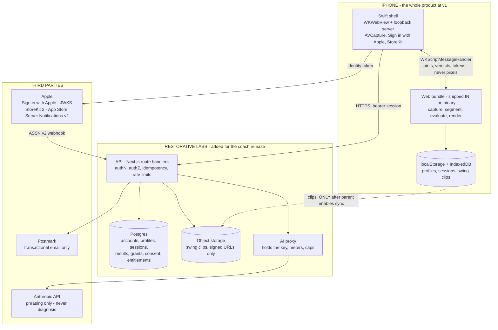
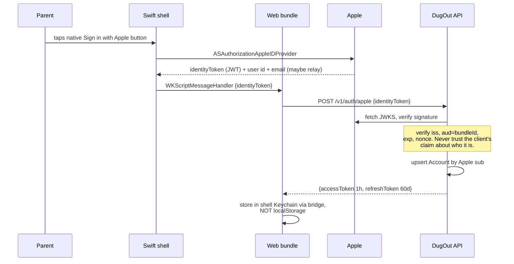
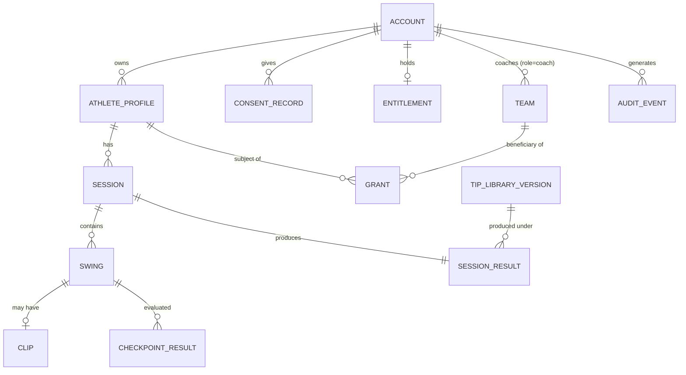
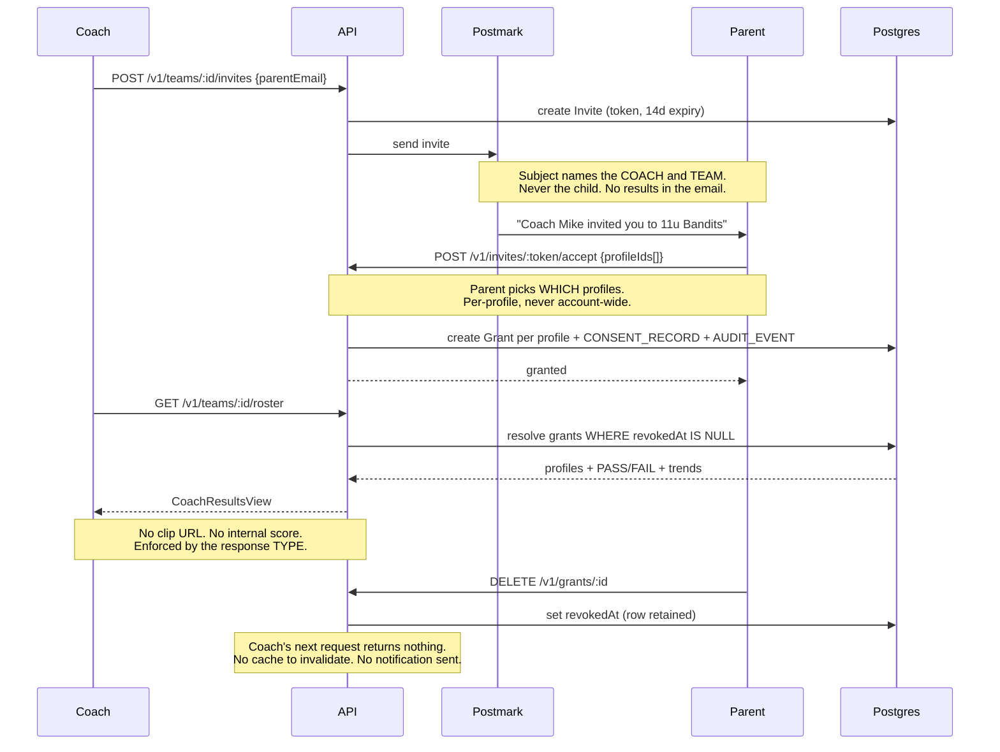

# DugOut — End-to-End Technical Design Document v1.0

**Date:** 2026-08-30 · **Status:** draft for Derell's review · **Supersedes:** the backend sketches in Epic E ticket descriptions
**Companion docs:** `DugOut_Segmentation_TDD_v1.0.md` (how swings are found) · `DugOut_Realtime_VLM_Plan_v1.0.md` (how feedback is voiced) · `DugOut_COPPA_Posture_Memo_v1.0.md` (what the law requires)

Tickets get mapped from this document, not the other way round. Section numbers are the mapping key.

---

## 1. Scope

Everything from the phone on the tripod to the database and back: identity, authorization, data model, API, media, payments, email, security, observability. Swing detection and feedback composition are specified in the companion docs and appear here only where they cross a system boundary.

**The commercial constraint this design serves:** sell to parents in **October 2026**, have **teams on it for the spring 2027 season**. That means revenue cannot wait for a backend, and the coach product cannot wait for spring.

---

## 2. Principles

These are load-bearing. Every design decision below traces to one, and violating one is a defect, not a trade-off.

1. **Local-first, always.** Capture, segmentation, evaluation and results work with **no network**. A batting cage has no signal. The cloud adds durability, multi-device and the coach view — it is never a dependency for the core loop.
2. **Raw session video never leaves the device.** It is deleted at segmentation. Only swing clips can ever be uploaded, and only after the parent enables sync.
3. **Internal checkpoint scores never cross the API boundary.** They are stored, they drive thresholds and trends, and the only thing a client ever receives is PASS/FAIL.
4. **The parent owns the record.** Every authorization decision resolves to "did the profile-owning parent grant this, and have they revoked it."
5. **Authorization is enforced at the API, never in the client.** A client-side filter is not a control.
6. **No third-party SDKs in the app.** Apitor was fined in September 2025 for what a vendor's SDK did. This is a hard rule, not a preference.
7. **Every object carries `profileId`.** Already true in the local store; it is what lets accounts bolt on without a rewrite.

---

## 3. System context



**What v1 (October) actually needs from the cloud: nothing.** The paid Player tier ships against the local-first app with StoreKit handling identity, receipt and renewal. Everything in the CLOUD box is the coach release.

---

## 4. Deployment tiers — what runs where, and when

| Tier | Component | Ships |
|---|---|---|
| **On device** | Capture, segmentation, six-checkpoint evaluation, Tip Library, rendering, clip storage | **Now** |
| On device | Sign in with Apple (native), StoreKit paywall + receipt, native chrome for App Review 4.2 | **Oct (v1.0)** |
| Cloud | API, Postgres, auth token exchange, entitlement, transactional email | **Nov (coach)** |
| Cloud | Object storage + signed clip URLs, sync | **Nov (coach)** |
| Cloud | AI proxy | **Before any shipped AI** |

**§4 → tickets:** the split above is the release boundary. Anything in the cloud tier that gets pulled into October is scope creep and should be refused.

---

## 5. Identity layer

### 5.1 The decision: Sign in with Apple only, at v1

Every iOS user has an Apple ID. SIWA-only means **no passwords, no password storage, no reset emails, no credential-stuffing surface, no breach to disclose**. For a solo founder shipping in six weeks, it is both the fastest and the most secure option, and App Review requires SIWA anyway the moment any other third-party sign-in exists (Guideline 4.8).

Add email sign-in **at the coach release**, not before, and only because a coach will eventually want a desktop browser. Magic link, not passwords.

### 5.2 The flow — and why it can't be done in the webview

OAuth inside a plain `WKWebView` is a bad experience and Apple's own flows resist it. The correct pattern uses the native shell:



**Three details that are easy to get wrong and expensive to fix:**

- **Verify the token server-side against Apple's JWKS.** The client tells us nothing we trust. Check `iss`, `aud` (our bundle ID), `exp`, and the nonce.
- **The Apple `sub` is the stable identity, not the email.** A user can change or hide their email; `sub` never moves.
- **Tokens live in the Keychain, reached over the bridge — never in `localStorage`.** Web storage in a webview is the wrong place for a bearer token.

### 5.3 The relay-email trap ⚠️

If a parent picks **Hide My Email**, Apple issues a `@privaterelay.appleid.com` address and relays our mail. **Apple requires every sending domain and address to be registered** in Certificates, Identifiers & Profiles → *Sign in with Apple for Email Communication*. Unregistered sources **bounce**. SPF DNS TXT records are mandatory; the envelope sender domain must match the registered domain, and DKIM `d=` must match the From: domain. Individual enrollments get **32 email sources**; organizations get 100.

**Why this matters more than it looks:** the coach-invites-a-parent email *is* the growth loop. If it silently bounces for every privacy-conscious parent, the loop is broken and it will look like poor conversion rather than a DNS problem. Register the domain the same day the sending domain is chosen.

**§5 → tickets:** native SIWA button + bridge · server-side JWKS verification + token exchange · Keychain token storage · Apple email-source registration + SPF/DKIM · magic-link email sign-in (coach release only).

---

## 6. Authorization model

The hard part of this system. Authentication is solved; **this** is where a mistake becomes a headline.

### 6.1 Subjects

| Subject | Who |
|---|---|
| `owner` | The parent who created the account and owns the profile |
| `athlete` | The kid, on the owner's device, in player view. No credentials at v1 |
| `coach` | Holds a **grant**, per profile, created by an owner, revocable at any time |
| `admin` | Restorative Labs. Aggregate and audit only |

### 6.2 The matrix

`R` read · `W` write · `D` delete · `—` no access at any level

| Resource | owner | athlete | coach (granted) | admin |
|---|---|---|---|---|
| Account | R W D | — | — | audit only |
| Profile (name, age band) | R W D | R | **R** | audit only |
| Session metadata | R W D | R | **R** | aggregate |
| **Swing clip bytes** | R D | R | **—** | **—** |
| Checkpoint PASS/FAIL | R | R | **R** | aggregate |
| **Internal checkpoint score** | **—** | **—** | **—** | aggregate, engine tuning |
| Trends / streaks | R | R | **R** | aggregate |
| Practice compliance | R (own) | R (own) | R (roster) | aggregate |
| Grant | **C D** | — | R (own) | audit |
| Team / roster | — | — | R W D (own) | audit |
| Entitlement | R | — | R (own) | R |
| Consent record | R (own) | — | — | audit |

### 6.3 The three rules that make it enforceable

1. **The coach view is a server-side type, not a filter.** `GET /v1/teams/:id/roster` returns a `CoachResultsView` — a distinct response type with no clip field, no score field, no raw anything. A future careless change *cannot* leak a clip URL, because the type has nowhere to put one. This is the single most important structural decision in the document.
2. **Every request resolves a grant, on every call.** No caching a coach's access. Revocation is instant because nothing is remembered between requests.
3. **Revocation is a state with a timestamp, never a deleted row.** We must be able to answer "who could see what, when." That is both a trust feature for parents and the audit trail §13 needs.

**§6 → tickets:** permission matrix as executable policy · `CoachResultsView` type + tests that assert it cannot serialize a clip URL · grant resolution middleware · revocation with retained history.

---

## 7. Data model



**Field-level decisions that matter:**

| Entity | Note |
|---|---|
| `Account` | Keyed on Apple `sub`. Stores email (may be relay) and `isAdult`. **Never stores a birth year** — see the COPPA memo §1 |
| `AthleteProfile` | `ageBand` enum only (`7-10` / `11-13` / `14-18`), never a date of birth. `bats` L/R. Owned by exactly one Account |
| `Session` | `capturedAt`, `swingCount`, `deviceLocalOnly` boolean. **`rawVideoDeletedAt` is a required non-null column** — it makes the invariant provable rather than merely claimed |
| `Swing` | `contactT`, `outcome`, `partial`. Clip is optional: a session can exist with results and no uploaded clips |
| `CheckpointResult` | `pass` boolean **and** `internalScore` — the score column exists and is never in any client-facing response type |
| `SessionResult` | Pinned to `tipLibraryVersionId` so a library update never silently rewrites history |
| `Grant` | `profileId`, `teamId`, `grantedAt`, `revokedAt` (nullable), `grantedByAccountId`. **Never hard-deleted** |
| `ConsentRecord` | Append-only. Wording version, timestamp, method, IP. No update path exists in code |
| `Entitlement` | `source` (apple_iap / coach_seat), `productId`, `expiresAt`, `originalTransactionId`. A profile can have two — that is the dual-subscription case, and it is why "no double charge" is resolvable |

**Retention** is specified in the COPPA memo §3 and enforced as a scheduled job, not a policy document.

**§7 → tickets:** Prisma schema · migrations · retention job · `rawVideoDeletedAt` not-null constraint · audit table.

---

## 8. API surface

Small on purpose. Next.js App Router route handlers, `/v1` prefixed, bearer session, JSON.

| Method | Path | Notes |
|---|---|---|
| POST | `/v1/auth/apple` | Exchange Apple identity token → session |
| POST | `/v1/auth/refresh` | |
| DELETE | `/v1/auth/session` | Sign out |
| GET | `/v1/me` | |
| **DELETE** | **`/v1/me`** | **Hard delete. Cascades to profiles, sessions, clips, object storage. App Review 5.1.1(v)** |
| GET POST | `/v1/profiles` | |
| PATCH DELETE | `/v1/profiles/:id` | |
| POST | `/v1/sessions` | Upload a completed session. **Idempotent on a client-generated `sessionId`** |
| GET | `/v1/sessions` | `?profileId=` |
| GET DELETE | `/v1/sessions/:id` | |
| POST | `/v1/clips/upload-url` | Returns a signed PUT target, 15-min TTL |
| GET | `/v1/clips/:id/url` | Signed GET, **5-min TTL**, owner only |
| GET | `/v1/profiles/:id/trends` | |
| POST | `/v1/teams` · GET `/v1/teams/:id` | Coach |
| POST | `/v1/teams/:id/invites` | Coach invites a parent by email |
| POST | `/v1/invites/:token/accept` | Parent accepts, selects **which profiles**, creates grants |
| DELETE | `/v1/grants/:id` | Parent revokes. Immediate |
| GET | `/v1/teams/:id/roster` | **Returns `CoachResultsView`. The type has no clip or score field** |
| POST | `/v1/entitlements/refresh` | StoreKit transaction → entitlement |
| POST | `/v1/webhooks/appstore` | App Store Server Notifications v2. JWS-verified |
| POST | `/v1/ai/compose` | The proxy. Verdicts + candidate tip IDs → phrasing |

**Cross-cutting, applied as middleware not per-route:** bearer auth → grant resolution → rate limit → idempotency → audit write. Every mutation emits an `AUDIT_EVENT`.

**§8 → tickets:** one per row group, plus the middleware stack as its own ticket.

---

## 9. Data flows

### 9.1 Capture → results (v1 — entirely offline)

```
prop phone → record 90s → segment (raw video DELETED) → 24 keyframes + 16 pose
samples per swing → six checkpoints PASS/FAIL → priority focus from Tip Library
→ render in the philosophy's voice → write to IndexedDB
```

**Zero network calls.** This is the whole October product and it already exists apart from the DUG-54 fix and segmentation reliability.

### 9.2 Coach invite → grant → read (the flow with all the authorization subtlety)



### 9.3 Subscribe → entitlement

**v1 (October):** StoreKit 2 on device. The transaction *is* the entitlement. No server.
**Coach release:** `POST /v1/entitlements/refresh` on launch and purchase, plus the **App Store Server Notifications v2** webhook for renewals, cancellations, refunds and billing retries. Payloads are JWS — verify the signature chain, don't trust the body. Server-side entitlement is genuinely required here because a coach's seat entitles *a different family's account*, which the client cannot be trusted to assert.

### 9.4 Delete account

`DELETE /v1/me` → cascade profiles → sessions → clips → **object storage bytes** → retain only the consent and audit records (which carry no clip and no child name). Emit a deletion receipt to the parent. This has a legal clock on it; it is a foreground operation with a confirmation, not a nightly batch.

---

## 10. Media pipeline

- **Raw session video never uploads.** Deleted at segmentation, and `rawVideoDeletedAt` proves it.
- **Clips upload only after the parent enables sync**, and only on unmetered networks by default — a cage on cellular should not eat a data plan.
- **Signed URLs only.** No public bucket, no guessable key, no permanent link. PUT 15 minutes, GET 5 minutes, owner-scoped.
- **Deletion is verifiable.** Deleting a clip, session, profile or account removes bytes, and we can demonstrate it.
- **~22 MB per session** at 15 clips. Storage and egress are real COGS — they feed the unit-economics model.

---

## 11. Email

Transactional only. **Postmark** — transactional-only reputation is exactly why its deliverability holds, and the invite is the growth loop.

| Email | Trigger | Contains |
|---|---|---|
| Coach invite | Coach invites a parent | Coach name, team name, accept link. **Never the child's name** |
| Grant confirmation | Parent accepts | What the coach can now see, and how to revoke |
| Revocation receipt | Parent revokes | Confirmation. **Coach is not emailed** |
| Deletion receipt | Account deleted | What was deleted, when |
| Magic link | Coach-release sign-in | Single-use, 10-min expiry |
| Weekly digest | Later, retention | Opt-in. Aggregate only |

**Rules, all of which follow from §2:**
- A child's name never appears in a subject line.
- No clip, no result, no image ever travels in an email body.
- Every link is single-purpose, expiring and authenticated on use.
- **Register the sending domain with Apple** (§5.3) before the first invite is sent.

---

## 12. Security

### 12.1 What we are actually protecting

Video of children, and the association between a child, a location and a weekly schedule. That second one is underrated and is why practice-compliance data is as sensitive as the clips.

### 12.2 Threats and controls

| Threat | Control |
|---|---|
| Guessable or shareable clip URL | Signed, short-TTL, owner-scoped. No public bucket |
| Coach sees more than results | `CoachResultsView` type, enforced server-side (§6.3) |
| Client asserts a profile it doesn't own | Grant resolution middleware on every request. The client's claim is never trusted |
| Revoked coach retains access | No cached authorization. Revocation effective on the next request |
| Leaked Anthropic key | Key lives only in the proxy. **The app never ships a key.** Per-account quotas server-side |
| Vendor SDK exfiltration | **No third-party SDKs.** See Apitor, Sept 2025 |
| Token theft from the webview | Tokens in the Keychain via the bridge, never `localStorage` |
| Replayed session upload | Idempotency on a client-generated `sessionId` |
| Cost abuse of the AI proxy | Per-account rate limit and monthly cap, enforced server-side |
| Insider / support over-reach | Admin has aggregate and audit only. No production clip access path exists |

### 12.3 Baseline
TLS everywhere. Secrets in the platform secret store, never in the repo — `CLAUDE.md` already forbids committing `.env` and keys, and a committed key is a compromised key: rotate, don't delete. Written security program with a named responsible person, annual risk assessment and vendor written assurances — **required by amended COPPA §312.8 once we collect anything.**

---

## 13. Observability

**What must never be logged, at any level, in any environment:** clip bytes or frames · pose keypoints · a child's name · internal checkpoint scores · auth tokens · Apple identity tokens. Logs reference `profileId`, an opaque identifier, and nothing else about a child.

**What to log:** every grant, revocation and coach read of a child's record → `AUDIT_EVENT`, append-only. That table is what answers a parent's "who has seen my kid's data," which is a trust feature, not just compliance.

**Metrics that decide things:** segmentation success rate · **real per-session COGS** (the number that sets the coach seat price) · sessions per user per week · free→paid conversion · invite acceptance rate · churn.

**Alerts:** API error rate, webhook failures (a missed renewal notification silently un-entitles a paying customer), AI proxy spend anomaly, deletion job failures.

---

## 14. Environments

`dev` / `staging` / `prod`, separated before there is real user data. **Staging carries synthetic athlete data only — never a real child's session, in any environment, for any reason.** Production credentials never touch a laptop. Rotation procedure written down.

---

## 15. Phasing against the commercial calendar

| Window | Ships | Needs from this document |
|---|---|---|
| **September** | Repo unblocked, DUG-54 fixed, segmentation reliable, native chrome, StoreKit paywall, TestFlight running | §4 device tier · §5.1–5.2 SIWA · §9.1 · §9.3 v1 |
| **October — revenue** | App Store v1.0, **paid Player tier from day one** | Apple paperwork (the real blocker) · nothing cloud-side |
| **Nov–Dec — teams buy** | API, Postgres, identity exchange, grants, roster, invites, email, sync | §5.3 · §6 · §7 · §8 · §9.2 · §10 · §11 · §12 |
| **Jan–Feb** | Philosophy voice overlay, between-swings VLM | §8 `/v1/ai/compose` · the VLM plan |
| **March** | Spring season, teams already on it | — |

**The one thing on the critical path to revenue is not in this document at all:** the Apple Paid Apps agreement, tax forms and banking. Nothing sells until it is Active — usually a day after the forms are in, documented worst case 90 days.

---

## 16. Open decisions

1. **Postgres host** — Neon, Supabase or RDS. Leaning Neon: branching per environment is genuinely useful for a solo operator.
2. **Object storage** — S3 or Cloudflare R2. **R2 has no egress fees**, which matters when the product is video playback.
3. **Do we need Clerk at all?** With SIWA-only and native, probably not — verifying Apple's JWT is ~50 lines against their JWKS. Revisit when magic-link email arrives.
4. **Sync default** — off (parent opts in) or on. Off is the safer COPPA posture and the stronger marketing claim; on is better retention and multi-device. **Recommend off at launch.**
5. **Coach on desktop** — the roster and dashboard want a real screen. Does the coach release include a web app, or is it iOS-only until spring?
6. **Region** — US-only at launch. Minors' data crossing borders is a question nobody needs in October.

---

## 17. What this document deliberately does not do

It does not specify a message bus, a microservice split, a cache layer, or background job infrastructure beyond a scheduled retention job. At the scale this business will be at in March — hundreds of families, dozens of coaches — a single Next.js app and one Postgres will not be the constraint, and every additional moving part is an operational tax paid by one person.

---

*Sources for the external facts asserted here:* [Apple — configure private email relay (registration, SPF, 32-source limit)](https://developer.apple.com/help/account/capabilities/configure-private-email-relay-service/) · [App Store Server Notifications v2 / StoreKit 2 JWS verification](https://developer.apple.com/videos/play/tech-talks/10887/) · COPPA §312.8, §312.10 and FTC FAQs A.8 / F.5 as cited in `DugOut_COPPA_Posture_Memo_v1.0.md`
